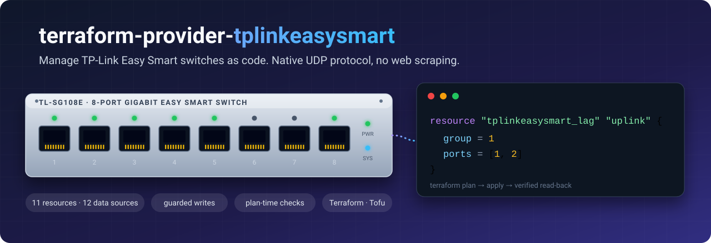

<p align="center">
  
</p>

<p align="center">
  <a href="https://github.com/davidlukac/terraform-provider-tplinkeasysmart/actions/workflows/test.yml"></a>
  <a href="https://github.com/davidlukac/terraform-provider-tplinkeasysmart/tags"></a>
  <a href="go.mod"></a>
  <a href=".github/workflows/test.yml"></a>
  <a href=".github/workflows/test.yml"></a>
  <a href="#testing"></a>
  <a href="https://registry.terraform.io/providers/davidlukac/tplinkeasysmart"></a>
  <a href="LICENSE"></a>
</p>

<p align="center">
  <b>Infrastructure as code for TP-Link Easy Smart switches.</b><br>
  Plan, review and apply your switch configuration like any other Terraform resource,<br>
  through the switch's native management protocol instead of a scraped web UI.
</p>

<p align="center">
  <a href="#quick-start">Quick start</a> ·
  <a href="#what-you-can-manage">What you can manage</a> ·
  <a href="#safety-by-design">Safety</a> ·
  <a href="#compatibility">Compatibility</a> ·
  <a href="https://registry.terraform.io/providers/davidlukac/tplinkeasysmart/latest/docs">Registry docs</a> ·
  <a href="https://github.com/davidlukac/escp-go/blob/main/PROTOCOL.md">Protocol</a>
</p>

---

<!-- The coverage number is measured by CI on every push to main (coverage.json on the
     `badges` branch). -->

> **Tested on:** TL-SG108E hardware v6, firmware 1.0.0 Build 20230218 and Build 20250710. Those are the only devices verified so far; other Easy Smart models are untested ([see the table](#compatibility), and [report yours](https://github.com/davidlukac/terraform-provider-tplinkeasysmart/issues/new?template=hardware_report.yml)).
> **A bad write can lock you out:** these switches have no console, and recovery from an unreachable management path is a physical factory reset. The provider refuses the risky changes by default, see [Safety by design](#safety-by-design) and [Constraints](#constraints-read-these). Released under the [MIT license](LICENSE).

## Why this provider

The Easy Smart line (TL-SG105E, TL-SG108E, TL-SG1016DE and friends) is cheap, quiet and capable, and it has no CLI, no API and no config-as-code story. The web UI is the only supported way in. This provider gives these switches one.

| | |
|---|---|
| **Native protocol** | Speaks the same UDP management protocol (ESCP) as the vendor's own utility. No HTTP session scraping, no HTML parsing, no browser. |
| **Read what is really there** | Data sources for ports, link state, statistics, LAGs, VLANs, QoS, rate limits, mirroring and the config backup. |
| **Safe by default** | Writes that could cut your own management path (a port with a link up, a LAG member) are refused unless you opt in with `allow_disruptive = true`. |
| **Fails at plan time** | Bad ports, VLAN ids, rates and cross-field mistakes are rejected while Terraform plans, before anything is applied. |
| **Verified read-back** | Every write is read back and compared, so a switch that silently ignored a change is reported, not trusted. |
| **Several switches** | One provider block can manage a whole fleet, per object, with their own credentials. |
| **Tested without hardware** | A fake UDP switch and real Terraform plan/apply/import/drift/destroy lifecycles run on every pull request, on five Terraform versions and OpenTofu. |

## Quick start

> **Status:** pre-1.0. Install from the [Terraform Registry](https://registry.terraform.io/providers/davidlukac/tplinkeasysmart) with `terraform init`; releases are signed. Until 1.0 a minor version may change behavior, so pin it (`~> 0.26`) and read the [changelog](CHANGELOG.md) before upgrading.

New to it, or trying a different model? Start with **only** the read-only data sources (`system_info`, `ports`): they confirm the login and the protocol on your switch and firmware without a single write.

```hcl
terraform {
  required_providers {
    tplinkeasysmart = {
      source  = "davidlukac/tplinkeasysmart"
      version = "~> 0.26"
    }
  }
}

provider "tplinkeasysmart" {
  host     = "192.0.2.120"      # or TPLINK_EASYSMART_HOST
  username = "admin"            # or TPLINK_EASYSMART_USERNAME
  password = var.switch_password # or TPLINK_EASYSMART_PASSWORD (sensitive)
}

# Read the current state of the switch...
data "tplinkeasysmart_system_info" "this" {}

data "tplinkeasysmart_ports" "this" {}

# ...and manage it.
resource "tplinkeasysmart_led" "this" {
  enabled = true
}

resource "tplinkeasysmart_loop_prevention" "this" {
  enabled = true
}

output "firmware" {
  value = data.tplinkeasysmart_system_info.this.firmware_version
}
```

Existing settings are best brought under management with `terraform import` (every resource documents its import id) so the first plan shows no change.

## What you can manage

Write support exists only where it cannot cut management access. Per-port and per-group writes are **guarded** (see [Safety by design](#safety-by-design)).

**Resources**

| Resource | Web UI page | Guard |
|---|---|---|
| `tplinkeasysmart_led` | System > LED On/Off | none needed |
| `tplinkeasysmart_system` | System > System Info (device description) | IP config re-sent unchanged and verified; skipped if unchanged |
| `tplinkeasysmart_management_ip` | System > IP Setting (static address, mask, gateway) | `allow_disruptive` for every change, between a static address and a DHCP lease included (`dhcp = true` needs the switch's `mac`) |
| `tplinkeasysmart_igmp_snooping` | Switching > IGMP Snooping | none |
| `tplinkeasysmart_loop_prevention` | Monitoring > Loop Prevention | none |
| `tplinkeasysmart_qos` | QoS > QoS Basic | priorities only in port-based mode |
| `tplinkeasysmart_port` | Switching > Port Setting | port in use / LAG member |
| `tplinkeasysmart_bandwidth_limit` | QoS > Bandwidth Control | port in use / LAG member |
| `tplinkeasysmart_storm_limit` | QoS > Storm Control | port in use / LAG member |
| `tplinkeasysmart_port_mirror` | Monitoring > Port Mirror | destination port in use / LAG member |
| `tplinkeasysmart_lag` | Switching > Port Trunk | old and new member ports |
| `tplinkeasysmart_vlan_port_based_group` | VLAN > Port Based VLAN | old and new member ports |
| `tplinkeasysmart_vlan_mode` | VLAN > MTU / Port Based / 802.1Q VLAN (the active mode) | `allow_disruptive` for every change |
| `tplinkeasysmart_vlan_8021q_group` | VLAN > 802.1Q VLAN | old and new member ports, no port left in no VLAN |
| `tplinkeasysmart_vlan_8021q_pvid` | VLAN > 802.1Q PVID Setting | port in use / LAG member |

**Data sources** (read-only): `system_info`, `ports`, `port_statistics`, `lags`, `port_mirror`, `qos`, `bandwidth_control`, `storm_control`, `vlan_mtu`, `vlan_port_based`, `vlan_8021q`, and `config_backup` (the configuration file, optional and sensitive).

Deliberately **not** writable: user account, config restore, reboot, factory reset and firmware upgrade. These are the changes that can lock you out of a device that has no console. The full reference for every resource and data source is in [`docs/`](docs/index.md) and on the [Terraform Registry](https://registry.terraform.io/providers/davidlukac/tplinkeasysmart/latest/docs).

## Safety by design

A managed switch is the one device you cannot reach when you misconfigure it. The provider is built around that.

- **Guards.** `port`, `bandwidth_limit`, `storm_limit`, `port_mirror`, `lag`, `vlan_port_based_group`, `vlan_8021q_group` and `vlan_8021q_pvid` refuse to touch a port that has a link up or belongs to a LAG, because that is how you cut your own uplink. Set `allow_disruptive = true` on the object to take the risk deliberately.
- **One limiter per port.** The switch keeps either an ingress bandwidth limit or storm control on a port and turns the other off without saying so. The client reads the other setting first and refuses the second one (`bandwidth_limit` with an `ingress_kbps` other than 0 while storm control is on, `storm_limit` with a traffic type while an ingress limit is set), so a configuration never undoes itself on the next refresh. To change over, switch the first off and order the applies with `depends_on`.
- **Management address.** `management_ip` moves the switch only with `allow_disruptive = true`, validates the address, mask and gateway while planning, and the client follows the switch to its new address and checks it answers there. With `dhcp = true` the switch takes the address its DHCP server gives it; that needs the switch's `mac` in the provider configuration, because only a lookup by MAC finds it again.
- **VLAN mode.** Switching between MTU, port-based and 802.1Q VLAN discards the other modes' settings and can cut every connection, so `vlan_mode` refuses unless `allow_disruptive = true`; applying the mode the switch already has writes nothing.
- **Firmware guard.** Writes are refused while the switch runs a firmware build this provider was not verified against (reads and imports always work). `allow_unverified_firmware = true` opts in, or set `TPLINK_EASYSMART_ALLOW_UNVERIFIED_FIRMWARE=true` in the environment (the argument wins; a switch entry overrides both).
- **Import the uplink, protect it.** Bring the LAG that carries your router uplink under management and add `lifecycle { prevent_destroy = true }`.
- **Plan-time validation.** Port numbers (1-32), VLAN ids (1-255), LAG groups (1 takes ports 1-4, 2 takes ports 5-8, two to four members), speeds, QoS modes and priorities (1-4), rate limits (0 or a multiple of 64 up to 1,000,000 kbps), device description (letters, digits, hyphens, up to 32) and cross-field rules (a storm limit needs a rate if a traffic type is selected, a mirror needs a destination that is not one of its sources) are checked before apply. The client repeats every check before it writes.
- **Read-back.** Each write is verified against the switch afterwards; a write the switch ignored is an error.
- **Back up first.** The `config_backup` data source returns the device configuration so you can keep a copy before a change.
- **No hardware needed for tests.** Everything above is exercised against a fake switch, including the failure paths.

## Naming a switch by its MAC address

An IP address can change (DHCP, a move); the MAC address does not. Put it in the configuration, with or without `host`:

```hcl
provider "tplinkeasysmart" {
  mac      = "c0:3a:55:6c:81:61" # or TPLINK_EASYSMART_MAC; `system_info` reports it as `mac_address`
  username = "admin"
  password = var.switch_password
}
```

- **It pins the identity.** Every reply names the device that sent it. A device with another MAC at `host` is refused before anything is written to it (credentials ride on every write, so an address reused by another device would otherwise receive them).
- **It finds the switch.** Without `host`, or when `host` does not answer, the switch is looked up by a layer-2 discovery on the first request: about half a second, once per switch and run. A dead `host` gets 1.5 s before the lookup.
- **Both together** is the sturdiest setup for a switch with a fixed address: `host` is tried first and `mac` guards it.
- The MAC is a claim, not a credential: anyone on the segment can claim any MAC, so it protects against accidents, not against an attacker (which this protocol cannot do anyway).
- Discovery stays on the layer-2 segment; a Terraform run in another subnet needs `host`. Resource ids and imports do not carry the address, so switching a configuration from `host` to `mac` changes no state.

### Adopting a switch by its MAC address

For a switch you already manage by `host`, or one you are setting up:

1. **Find the MAC.** It is usually printed on the label on the case, and the router's DHCP lease table lists it next to the switch's address. Or read it from the switch itself: with `host` set, add `output "mac" { value = data.tplinkeasysmart_system_info.this.mac_address }` next to the `system_info` data source and run `terraform apply` (only reads happen; the state records the output).
2. **Add it next to `host`** in the provider block (or in the switch's entry of `switches`), and run `terraform plan`: it shows no changes, and any other device at that address would now be refused.
3. **Drop `host` later if you like** (for example when the switch leases its address): the switch is then found by its MAC on the first request. Nothing in the state changes, because resource ids do not carry the address.

A switch that leases its address (`dhcp = true` on `tplinkeasysmart_management_ip`) needs `mac`, because the leased address is not known in advance.

## Several switches

Either declare one provider alias per switch, or define them as data and pick one per object:

```hcl
variable "switches" {
  type      = map(object({ host = optional(string), mac = optional(string), username = string, password = string }))
  sensitive = true
}

provider "tplinkeasysmart" {
  switches = var.switches
}

resource "tplinkeasysmart_loop_prevention" "this" {
  for_each = toset(nonsensitive(keys(var.switches))) # names are not secret
  switch   = each.key
  enabled  = true
}
```

- `switch` is optional everywhere. Omitted, it means the provider's own switch (`host`) or the only configured one; with several switches and no default, planning fails and lists the names.
- Ids and import ids of a named switch are prefixed with its name (`sw02:led`, `sw02:7`). The provider's own switch keeps plain ids.
- Changing `switch` replaces the object, because it is a different device.
- The same host or MAC cannot appear twice. A complete example is in [`examples/multi-switch`](examples/multi-switch).

## Compatibility

<!-- compatibility-table:begin (generated from the safety package of github.com/davidlukac/escp-go: make compat-table) -->

| Switch | Hardware | Firmware | Status |
|---|---|---|---|
| TL-SG108E | v6 | 1.0.0 Build 20230218 | **Verified**: reads and writes checked on a real device, and the settings read back. The VLAN mode, 802.1Q VLAN and PVID writes were not tried on this build (they are verified on 20250710; same protocol generation). |
| TL-SG108E | v6 | 1.0.0 Build 20250710 | **Verified**: reads; the writes on unused ports (including mirror egress, unknown-unicast storm control and the VLAN mode, 802.1Q VLAN and PVID), the management address and the DHCP lease (the switch found again by its MAC address). LAG creation works as on 20230218 (group 1 takes ports 1-4, group 2 ports 5-8). |
| TL-SG108E | v6 | builds newer than 20250710 | Untried; reads work; `safety.FirmwareGate` refuses writes unless the caller opts in. Start with the reads |
| TL-SG108E | other hardware versions | any | Untested |
| Other Easy Smart models (TL-SG105E, TL-SG1016DE, ...) | any | any | Untested; reports wanted |
| Any | any | firmware **before the 2023 RSA key exchange** | Not supported: the client always performs the key exchange and has never been tried against the older login |

<!-- compatibility-table:end -->

The table is the one of the [ESCP library](https://github.com/davidlukac/escp-go) the provider is built with. On a firmware build that is not listed as verified the provider refuses writes unless `allow_unverified_firmware = true` (or the environment variable `TPLINK_EASYSMART_ALLOW_UNVERIFIED_FIRMWARE` is set); reads always work. The provider's own resources, imports and drift detection were verified on both builds marked Verified (the VLAN mode, 802.1Q group and PVID resources on 20250710 only).

Other Easy Smart models are expected to speak the same protocol family; that is a hope, not a claim. Reports (even "the read-only data sources work" or "login is rejected") fill in this table, see [Contributing](#contributing).

| Tool | Tested |
|---|---|
| Terraform | 1.4 and later, tested on 1.4, 1.6, 1.8, 1.10, 1.12, 1.14, 1.16 and latest (1.17 at the time of writing); the newest pre-release, when there is one newer than the latest stable, in an informational job |
| OpenTofu | The latest release (informational job) |
| Go | The version in [`go.mod`](go.mod) and the latest stable, for building from source |

Behavior of other models and firmware is documented in the [protocol notes](https://github.com/davidlukac/escp-go/blob/main/PROTOCOL.md) as it is verified.

## Constraints (read these)

- **Same layer-2 network only.** ESCP is UDP broadcast based; run Terraform on a host in the switch's subnet.
- **One client per switch at a time.** Don't run two clients against the same switch concurrently; an old client that binds the reply port exclusively (for example an old Easy Smart utility) blocks the provider until it is closed. Several *different* switches work at once.
- **No real security on the wire.** The protocol's encryption keys are public or trivially breakable (see the [protocol notes](https://github.com/davidlukac/escp-go/blob/main/PROTOCOL.md)). Keep the switches on a trusted management network.

## Troubleshooting

Set `TF_LOG=DEBUG` (or `INFO`) to see what the client does: every request and reply with its operation, sequence number and the TLV types and sizes, a lost packet and the retry, a session reopened, the switch located by MAC, the writes sent. Values are never logged, so the output holds no password or user name; it is still a log of your network, so look it over before sharing it.

## How it works

The provider talks UDP port 29808/29809 on the switch's own layer-2 segment: discovery, an RSA session-key exchange, RC4-encrypted TLV requests, then reads and writes with read-back. The wire format, every TLV layout and what was verified live are in the library's [`PROTOCOL.md`](https://github.com/davidlukac/escp-go/blob/main/PROTOCOL.md).

```
internal/provider             provider, resources and data sources, guards, validation
github.com/davidlukac/escp-go the ESCP client library (its own repository): UDP client, settings, wire codec,
                              write gates (package safety), fake switch (package escptest)
templates/                    docs templates      examples/   runnable examples used for the generated docs
```

## Development

```sh
make hooks              # once per clone: enable the pre-commit hook (gofmt, vet, lint, tests, coverage)
make test               # unit + Terraform lifecycle tests against fakes (needs `terraform` on PATH)
make lint               # golangci-lint, the version pinned in devtools/go.mod
make cover              # tests with -race and the coverage policy
make regression         # end-to-end scenarios (real Terraform, real provider, wire protocol) against the stateful fake switch
make generate           # regenerate docs/ from the schema and examples/
make validate-examples  # every documentation example against the schemas
make snapshot           # dry-run of the signed release build
```

### Building from source

```sh
go build -o bin/terraform-provider-tplinkeasysmart .
```

then point a CLI config at it (`~/.terraformrc`) instead of the Registry copy:

```hcl
provider_installation {
  dev_overrides {
    "davidlukac/tplinkeasysmart" = "/path/to/terraform-provider-tplinkeasysmart/bin"
  }
  direct {}
}
```

### Testing

The coverage badge is the **measured** statement coverage of the module, computed by CI on every push to `main` (exclusions are counted as not covered). The *policy* below is stricter than a number: it fails the build on any uncovered statement.

Policy: **every statement is covered**, except inside functions whose doc comment says `// coverage: ignore - <reason>` (the reason is mandatory; `tools/coverpolicy` (`go run ./tools/coverpolicy check cover.out`) fails the build without it and lists every exclusion). A test must fail when the behavior it names is broken; safety checks are never removed to raise a number. Test files are not measured, and the library (`escp-go`) has its own tests and its own policy.

Failure paths are exercised without hardware:

- [`escp-go`](https://github.com/davidlukac/escp-go) (the library): its fake UDP switch (package `escptest`) can be scripted per request, stay silent, reject the key exchange, reject the *n*th SET, or replace its discovery reply.
- `internal/provider`: a fault-injecting client wraps the in-memory fake and fails specific calls of any method, or accepts writes without applying them; every resource is driven through the same failure scenarios (write rejected, read-back fails, write ignored, update fails, refresh fails, bad import id, object vanishes).

- `internal/regression`: the same scenarios run against the stateful fake (`make regression`, in CI with the lifecycle tests) or, from a gitignored `.test.env` (see `.test.env.example`), against one designated test switch (`make regression-live CONFIRM=1`; never in CI; switch 01 is refused by name and address). Every scenario changes a setting, checks it by reading the switch directly, restores the original values by configuration and proves the readout of the whole switch is identical. Two scenarios are opt-in on hardware: the move of the management address to a spare address and back (`TPLINK_REGRESSION_ALLOW_MANAGEMENT_MOVE=1`, `TPLINK_REGRESSION_MOVE_IP`) the write to a port that carries a device (`TPLINK_REGRESSION_DISRUPT_DEVICE_PORT`) and the disruptive scenarios (`TPLINK_REGRESSION_DISRUPTIVE_PORTS`: real changes behind `allow_disruptive` on device ports; they always run on the fake).

CI runs the unit suite on the module's Go version and the latest stable, the lifecycle tests on five Terraform versions and OpenTofu, the linter, a generated-docs check, a vulnerability scan and a release dry run.

## Contributing

Issues and pull requests are welcome. Run `make hooks` once: the pre-commit hook runs the same checks as CI (format, vet, lint, tests with `-race` and the coverage policy), about a minute and a half. Please open an issue first for a new setting; [`CONTRIBUTING.md`](CONTRIBUTING.md) is the checklist for any change to the client, a resource or a data source (code, tests, documentation, release). Changes go through a pull request with [Conventional Commits](https://www.conventionalcommits.org/) titles and need green CI; see [`RELEASING.md`](RELEASING.md) for how versions are cut. Reports of other models or firmware are especially useful: use the [hardware report template](https://github.com/davidlukac/terraform-provider-tplinkeasysmart/issues/new?template=hardware_report.yml), which starts from a read-only configuration.

## License

MIT, see [LICENSE](LICENSE).

## Disclaimer

This is an independent project. It is not affiliated with, endorsed by, or supported by TP-Link. "TP-Link" and "Easy Smart" are trademarks of their owners and are used only to describe the hardware this provider works with. Use it at your own risk: you are changing the configuration of live network equipment.
